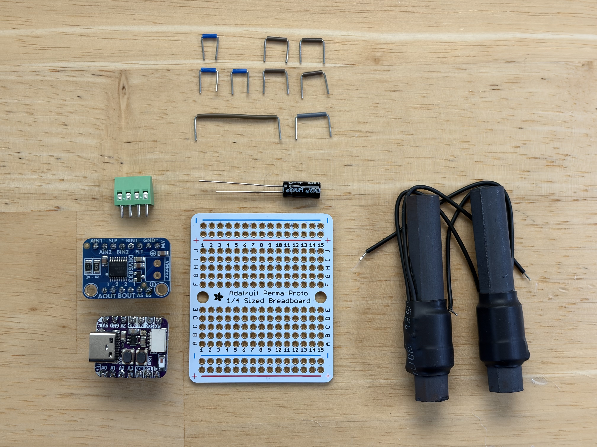
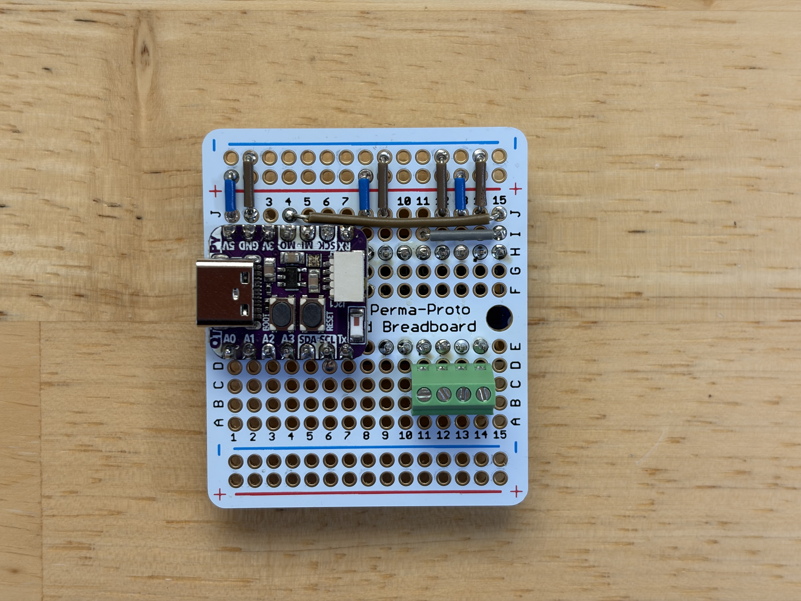
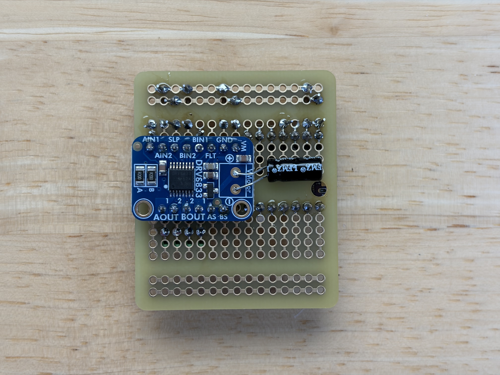

# The Watch Tower WWVB transmitter


There are some beautiful radio-controlled watches available these days from Citizen, Seiko, Junghans, and even Casio. These timepieces don’t need fiddling every other month, which is great if you have more than one or two and can never remember what comes after “thirty days hath September…”

In the US, these watches work by receiving a 60-bit 1-Hz signal on a 60-kHz carrier wave broadcast from Fort Collins, Colorado called [WWVB](https://en.wikipedia.org/wiki/WWVB). The broadcast is quite strong and generally covers the entire continental US, but some areas of the country can have unreliable reception. I live in the SF Bay Area in an area with high RF noise and my reception can be spotty. My watches sync often enough that it’s not an issue 363 days out of the year, but sometimes they can miss DST shifts for a day or two. The east coast is known to be even more challenging. And people who live in other countries such as Australia have generally been out of luck.

Wouldn’t it be great if anyone anywhere in the world could set up a home transmitter to broadcast the time so their watches were always in sync?

WWVB has been around awhile and there have been various other projects ([1](https://www.instructables.com/WWVB-radio-time-signal-generator-for-ATTINY45-or-A/),[2](https://github.com/anishathalye/micro-wwvb)) that have demonstrated the feasibility of making your own WWVB transmitter. But these all had very limited range. I wanted to build something that could cover my whole watch stand and be based on a more familiar toolset for the typical hobbyist, namely USB-based 32-bit microcontroller development boards, WiFi, and Arduino. My goal was to make something approachable, reliable, and attractive enough it could sit with my watch collection.

## Is this legal?

The FCC requires a license to transmit, but has an [exemption](https://www.law.cornell.edu/cfr/text/47/15.209) for 60 kHz transmitters as long as the field strength is under 40 *μ*V/m at 300 meters. You will [definitely not](https://github.com/emmby/WatchTower/issues/9) exceed this limit 💪🏼

## About WWVB

The classic WWVB transmits one bit of information per second (1Hz) and takes one minute (60 bits) to transmit a full time and date frame.

### An example

Here’s an example of one 60 second time encoding (graphic designed for "light mode"):


You can see that the minute of the time is encoded in the first 10 seconds of the window. The hour is in the next 10 seconds, the day is between seconds 22 and 33, etc.

If we wanted to indicate that the time was 30 minutes past the hour, for example, we would set bits 2 and 3 (20 and 10) to “high”. 

| **Bit** | **00** | **01** | **02** | **03** | **04** | **05** | **06** | **07** | **08** | **09** |
| --- | --- | --- | --- | --- | --- | --- | --- | --- | --- | --- |
| **Value** |  | 40 | 20 | 10 |  | 8 | 4 | 2 | 1 |  |
| *Example: 30* |  | *0* | *1* | *1* |  | *0* | *0* | *0* | *0* |  |

Similarly, the 7th hour of the day would be 0000111 for bits 12 thru 18.

### It’s a trit, not a bit.

How do we represent “high” and “low” for each 1s bit? You might think it would just be a high voltage for high and a low voltage for low, like you would use on a digital arduino pin, but that’s not how it’s done.

WWVB “bits” are actually not just 0 and 1. They’re actually "trits” because they can represent a 0, 1, or a “mark”, and this is one reason why we can’t just use a simple high/low to represent them. The mark is important to allow simple receivers to orient themselves within the signal window. Your watch knows that the last second in the window and the first in the next window are both “marks”, and so it knows to start a new window whenever it sees two marks in a row.

WWVB uses **Pulse Width Modulation** (PWM) to represent the three possible trit states. In a given 1 second bit, the width of the pulse determines whether the bit is a 0, 1, or mark.

- If power is reduced for one-fifth of a second (0.2 s), this is a data bit with value zero.
- If power is reduced for one-half of a second (0.5 s), this is a data bit with value one.
- If power is reduced for four-fifths of a second (0.8 s), this is a special non-data "mark", used for framing.

| **Low** | **Trit value** |
| --- | --- |
| 0.2s | 0 |
| 0.5s | 1 |
| 0.8s | mark |

Coming back to that original example but just focusing on the Minutes section, you can see the trits in the color encoding of the diagram. 


 `Light blue` is high and  `Dark blue` is low. You can see second 00 is dark blue (low) for 0.8s, which means it’s a “mark”.  Second 01 is dark blue for 0.2s, so it’s a 0. Second 02 is dark blue for 0.5s so it’s a 1, and so on.

So now you know how to encode the time and date using WWVB!

### The carrier wave

There’s one more part of the signal that needs explanation. While we’re transmitting bits at a frequency of 1 bit per second (1 Hz), we’re actually doing it on top of a 60 kHz carrier wave by varying the amplitude of the carrier wave.

Like we said in the previous section, we represent a high/low/mark trit by the width of our pulse. High for 200ms is a zero, high for 500ms is a 1, high for 800ms is a mark. The way we’ll do that on our 60 kHz carrier wave is by using PWM again, but this time on the 60 kHz signal instead of on the 1 Hz signal. We’ll use a duty cycle of 50% to represent High, which means that half of our 60 kHz pulse is high and half is low. We’ll use a duty cycle of 0% to represent Low which effectively means the whole pulse is low.
 
 

 So what you'll expect to see when you're transmitting a WWVB "mark" is a 1s pulse where half of the pulse is "high" using a 60 kHz signal at 50% duty, and the other half is "low" with a 0% duty (not to scale):

 

 Similarly, a 0 would be a 60 kHz 50% duty cycle for 0.2s, followed by a 0% duty cycle for 0.8s. And a 1 would be the reverse.

### The layers of WWVB

In summary, a WWVB date/time is encoded using a few different layers of encoding. At the top is what we think of as a date/time and at the bottom is the 60 kHz carrier wave.

|  |
| --- |
| A date/time is encoded as a… |
| 60-bit frame, using… |
| 1s PWM trits, on top of a… |
| 60 kHz 50% duty cycle carrier wave |
| 🐢🐢🐢 all the way down |

Now that you understand how it works, let’s build the transmitter!

## Components



- An ESP32-based development board such as the AdaFruit QT Py ESP32, AdaFruit Feather ESP32 v2, Arduino Nano ESP32, Seeed Xiao ESP32C3 or similar. I used the [QT Py ESP32](https://www.adafruit.com/product/5395).
- An H-bridge amplifier circuit. You can build your own, or I used the [Adafruit DRV8833 DC/Stepper Motor Driver Breakout Board](https://www.adafruit.com/product/3297). Boards using the TB6612 would probably also work, you just need something that can handle 5V or more, a few hundred milliamps and a switching frequency of 60khz or higher.
- Two [60khz ferrite rod antennas](https://www.canaduino.ca/product/60khz-atomic-clock-receiver-v4-wwvb-msf-jjy60/). You can pull these from existing quartz radio-controlled movements, or I bought mine from Canaduino. (You can leave out the second antenna if you want, though using two at a 90 degree angle gives much better reception across different watch orientations.) Some users have had luck with a simple 20 inch length of straight copper wire, but I found the signal to be too weak to be reliable.
- A **100µF 16V electrolytic capacitor** (47µF–220µF rated at 10V or higher also works) to buffer the amplifier power supply and absorb inductive flyback when driving the antennas from USB power.
- A breadboard (for prototyping) or [Adafruit 1/4-sized Perma-Proto](https://www.adafruit.com/product/589) (shown above, fits the 3D-printed enclosure), and [jumper wires](https://www.amazon.com/dp/B08YRGVYPV).
- A 4-pin PCB Mount Screw Terminal Block connector to connect your antennas, something like [this](https://www.amazon.com/dp/B09F6TC7RP). Not strictly necessary but nice to have (or a 2-pin terminal if you only plan to use a single antenna).

## Optional

None of the following is necessary, but some of it might be nice to have.

- **Oscilloscope**. It can be hard to know if your circuit is doing anything without an oscilloscope. There are some micro DSOs for around $100, and some android-based table DSOs for around $200, but I like the Rigol DHO800 series as an entry-level oscilloscope if your budget can stretch to around $400. A digital multimeter or an individual LED can also be helpful in a pinch.
- **10V power supply**. If you need more power you can use an external power supply. I found the signal to be strong enough without it and preferred the convenience of a single USB power supply. If you want to go up to 13V, switch to the [TB6612](https://www.adafruit.com/product/2448)
- **3D printer** if you would like to print the tower enclosure for your circuit.
- **Permaboard** or **Perma-proto**. After you’ve prototyped your circuit you’ll want to move it to something more permanent. An [Adafruit 1/4-sized Perma-Proto](https://www.adafruit.com/product/589) is convenient because it matches a standard breadboard layout and fits directly into the 3D-printed enclosure without needing to be cut. Permaboard is more configurable but less convenient.
- **Soldering iron**. If you’re using permaboard, you’ll need a soldering iron. I love the [Pinecil v2](https://pine64.com/product/pinecil-smart-mini-portable-soldering-iron/), it’s USB-powered, auto-sleep, nearly instant-on, open-source and temperature controlled.

## Instructions

### Simulator

Before you get started, you might be interested to see a simplified version of the software in action on the Wokwi Arduino online simulator.

[](https://wokwi.com/projects/431240334467357697)
https://wokwi.com/projects/431240334467357697

This simulator connects a virtual Arduino to a virtual logic analyser on PIN 4, and lets you download the output
of PIN 4 for offline viewing on your computer.

To use it:

- Run the simulator for a few seconds. Notice that D0 is
  flashing on the logic analyzer. The logs will also show
  the current date/time (which starts at Jan 1 1970 since
  we aren't using wifi to initialize it to another value)
- Stop the simulator. The logic analyzer will automatically
  download `wokwi-logic.vcd` to your computer.
- Open `wokwi-logic.vcd` in a viewer like [PulseView](https://sigrok.org/wiki/PulseView)


### Software

https://github.com/emmby/WatchTower

Upload the Arduino sketch to your Arduino using the Arduino IDE.

The LED will light up yellow/orange while connecting to WiFi. If you haven’t yet set your SSID, connect your phone to SSID: `WatchTower` and follow the instructions to enter your wifi password.

Once the network is connected and the time has sync’d, the light will turn green briefly and then turn off.

**Built-in Web UI (`http://watchtower.local`)**

Once connected to WiFi, the Watch Tower hosts a built-in web dashboard accessible at `http://watchtower.local` (or via your board's local IP address). It displays:

- **Broadcast Waveform**: A live 60-second visual waveform and table (`M`, `0`, `1` for seconds `00`–`59`) showing the current frame as it is transmitted in real time.
- **Current Time**, **Date**, and configured **Timezone**.
- **System Uptime** and **Last NTP Sync** timestamp.

If you prefer not to run a web server on your local network, you can disable it by setting `ENABLE_WEB_UI = false` in `WatchTower.ino`.

**Setup()**

The Arduino setup() method does a few things.

Initialize the components we’ll be using, particularly the serial port, LEDs, WiFi, mDNS + Web UI (`http://watchtower.local`), output pins, timezone, and network time sync (NTP). The network time sync will happen automatically in the background every hour. This is important because the realtime clock (RTC) on most microcontrollers are notoriously subject to drift and are rarely accurate for more than a few hours.

Start the 60 kHz carrier wave and register a 10ms high-priority hardware timer (`esp_timer`) to drive the WWVB pulse-width transitions without jitter from WiFi or Web UI activity.

**Signal Timer & Loop()**

A 10ms `esp_timer` callback (`onSignalTimer`) continuously reads the UTC time from the RTC, computes whether the 60 kHz carrier wave should be set to 50% (logical high) or 0% (logical low) for that specific moment in time, and updates `PIN_ANTENNA` immediately on each edge. Time is always UTC, except for the DST bits which are relative to your local timezone.

Meanwhile, `loop()` continuously performs the following background operations:

- Update the local timezone DST flags (`today_start_isdst` and `tomorrow_start_isdst`).
- When a signal transition occurs, log the timestamp and logic state to Serial and update the Web UI (`http://watchtower.local`) once per second with the latest time, uptime, and broadcast waveform.
- [Optional] Flash the onboard NeoPixel LED for high/low PWM. This is nice for making sure things are working, but it’s grounds for divorce in the bedroom.
- Reboot if NTP has not synced in more than 24 hours (deferred until after 12:00 PM local time so it never interrupts overnight watch syncs).

### Verify the microcontroller alone

If you installed and ran your software and you set up the wifi connection, your board should now be outputting a signal on your output pin.

If you have an LED, you can connect the long end (anode) to your output pin and the other end to ground. If everything is working it should flash on/off about once a second.


If you have a digital oscilloscope, you should be able to see a 3V square wave with a periodicity of 16us (1 / 60,000) something like the following:


That’s the 50% duty cycle PWM carrier wave initialized during setup().

If you zoom out to say 1 second per grid square resolution, you’ll be able to see the WWVB signal clearly:


In the 10 seconds shown here, I see a 1, mark, 0, 1, 1, mark, 1, 1, 1, and 1.

Now if you modify the software to hardcode the date to Mar 6, 2008 7:30:00 am and zoom out to see a full 60 seconds, your signal should exactly match the signal in the example we started with:

```c
  buf_now_utc.tm_year = buf_now_local.tm_year = 108; // 2008 = 1900 + 108
  buf_now_utc.tm_yday = buf_now_local.tm_yday = 65;
  buf_now_utc.tm_mon = buf_now_local.tm_mon = 2;
  buf_now_utc.tm_mday = buf_now_local.tm_mday = 6;
  buf_now_utc.tm_hour = buf_now_local.tm_hour = 7;
  buf_now_utc.tm_min = buf_now_local.tm_min = 30;
```


Looks great! Everything is working as expected.

### Electronics assembly

Now that you’ve verified the microcontroller is working, it’s time to put all the components together.

The electronics consist of three basic components: the microcontroller board, the amplifier breakout board (with bulk capacitor), and the antennas.

The connections are quite simple, you can do them on a breadboard or a proto board. I recommend starting with a breadboard first, and then soldering onto a 1/4-sized Perma-Proto board with the microcontroller and jumper wires on the front and the DRV8833 mounted on the back so everything fits compactly:





**Microcontroller board** (Adafruit ESP32 QT Py, mounted on the front at `I1–I7` and `E1–E7`)

- Connect the 5V pin to the `+` power plane (photo: J1).
- Connect the ground pin to the `-` ground plane (photo: J2).
- Connect your signal pin [MO] to the input pin of your amplifier [AIN1] (photo: J4>J15).

**DRV8833 Amplifier breakout** (mounted on the **back** at `H8–H15` and `E9–E14`)

Mounting the amplifier breakout on the back of the 1/4-sized Perma-Proto board keeps the footprint small enough to fit into the enclosure without cutting the PCB, and leaves the STEMMA QT I2C connector on the QT Py accessible. Note that because the DRV8833 is soldered to the back of the board, its pins run from column 15 (`AIN1`) on the right side of the front view down to column 8 (`VM`) near the middle:

- Connect the second input pin [AIN2] of your amplifier to ground (photo: J14).
- The Adafruit DRV8833 motor driver board has a sleep pin [SLP] that needs to be pulled high to enable the breakout, so connect that to 5V or 3V power, whatever is convenient. We used 5V here. (photo: J13)
- Connect ground [GND] to the ground plane. (photo: J9)
- [Optional] Connect the “motor” voltage [VM] to your 5V plane (photo: J8). This is needed if you are powering your amplifier via USB like I have here, but it should not be done if you are planning to use an external power supply on VMotor.
- **100µF 16V Capacitor**: Solder the capacitor across the `VMotor` `+` and `-` pads on the DRV8833 breakout (mind the polarity: negative stripe to `-`, positive lead to `+`) and bend it flat against the back of the board. Driving two inductive ferrite rod antennas at 60 kHz draws rapid current pulses and returns inductive flyback energy to the supply rail; this capacitor buffers the 5V USB rail against voltage spikes and brownouts.
- Connect [BIN2] to ground (photo: J12) and connect [BIN1] to [AIN1] (photo: I11>I15) to drive the second antenna channel. (You can leave these two jumpers out if you choose to only use a single antenna.)

**Antennas**

- You can plug your antennas directly into your breadboard, or use a 0.1" Pitch PCB Mount Screw Terminal Block Connector on the front of the board connected to [AOUT1], [AOUT2], [BOUT2], and [BOUT1] (photo: C14, C13, C12, C11). (If you choose to leave out the second antenna, you only need [AOUT1] and [AOUT2].)

  The orientation of the antenna has a profound effect on the strength of the signal. Mounting two antennas at a 90 degree orientation to each other doesn't produce a more powerful signal, but it significantly increases the chance that your watches will be able to pick up a signal from more orientations (see the section on antenna orientation below). The amplifier can easily handle two antennas.

  With one antenna, I was getting around 12 inches of range with the way my watches were oriented. With the second antenna, that jumped up to more than 6 feet!

  The STL tower has a hole in the center to allow space for a 60mm ferrite rod antenna mounted vertically. Add a piece of electrical or masking tape to the end of the vertical antenna to prevent it from abrading the PCB or shorting the contacts.


### Signal Verification

You should be able to do the same LED trick as last time, only this time with the long anode on AOUT1 and the short cathode on AOUT2.

Or with your oscilloscope, you can look at the output of your microcontroller and compare it to the output of your amplifier:


Here the 3V signal on the microcontroller is blue, and you can see that the amplifier is outputting a similar wave but at 5V. If your wave doesn’t look quite like this, check that your antenna is plugged in. The antenna has an impedance that will cause the ringing that you see in the waveform, that’s expected and okay.

The final test is to verify it works with a real watch!


### Assembling the enclosure

The enclosure is designed to fit an [Adafruit 1/4-sized Perma-Proto](https://www.adafruit.com/product/589) (43mm x 51mm) directly without any trimming. Feel free to modify the Autodesk Fusion file if you are using a different board size.

Print the enclosure using a 3D printer. I used standard PLA, standard 0.4mm nozzle, and pretty much default slicer settings with no supports.

* STL: [The Watch Tower.stl](enclosure/The%20Watch%20Tower.stl)
* Autodesk Fusion: [The Watch Tower.f3d](enclosure/The%20Watch%20Tower.f3d)


Insert the circuit board into the base, fit the vertical antenna into the hole in the tower, and place the horizontal antenna in the base. Then press the lid for a snap fit.

## Enjoy!

Plug into USB and you’re done! Your watches should now sync automatically every night.


## Signal strength

### How does distance affect signal strength?

You probably expect the signal to decrease as you get further away from the tower, but you might be surprised by how quickly the signal disappears.

The "inverse square law" tells us that RF signal strength decreases with the square of the distance. We can measure our signal strength using our oscilloscope, another antenna, and a ruler.


At one inch, our signal strength looks pretty solid! You can see that our 5V antenna square wave (yellow) is inducing a 16V sinusoidal wave in our receiving antenna. It's a little counter-intuitive that the receiving amplitude would be larger than the sending amplitude, but RF physics is beyond the scope of this README. Which is another way of saying 🤷.


Here are my readings as I move the receiver antenna further out. As expected, the amplitude decreases by roughly 4X as the distance doubles. 

| Distance | Amplitude |
|----|---|
| 1" | 24.2V |
| 2" | 6.7V |
| 4" | 1.2V |
| 8" | 301mV |
| 16" | 93mV |
| 32" | 28mV |

When you zoom out, the one second pulses are still clearly distinguishable to the human eye, but it gets harder and harder as you get further away.


This is all fine and good, but seeing a wave on an oscilloscope doesn't necessarily mean the watch can pick it up. We'll get into that shortly.


### How does orientation affect signal strength?

Quite a lot!

Turning the receiver antenna 90 degrees drops the signal by 75%!


Most watches receive their strongest signal through the watch face. For the best reception you should point your watch toward the tower (or toward Colorado). This may make more of a difference than a few inches of distance.

This doesn't matter for watches on the stand where the signal is strong, but it can make a difference for watches that are further away.

This is why I recommend two antennas at right angles from each other.

### Does the enclosure affect signal strength?

Plastic enclosures have a negligible effect on signal strength. The Watch Tower enclosure printed using generic PLA has maybe 5% or less of an impact on signal strength. Again, a few degrees of orientation will have a larger effect than an enclosure.

|||
|-|-|
|No enclosure   | 1.02V |
|Base           | 952mV |
|Fully enclosed | 987mV |

### How far away can my watch pick up the signal?

Watches vary in terms of their antenna design, their enclosures, antenna orientation, signal-to-noise filtering, etc.

I tested with a Junghans Max Bill Mega Solar 59/2021.02 (Seiko movement) and a Casio Lineage LIW-M700D (Casio movement). In practice, the orientation of your watch will probably have orders of magnitude more influence on your reception than the model of your watch.

Using the SINGLE antenna, I made five attempts with each watch at a distance of 9" with the antenna and the watch both flat on the surface. To minimize interference from Fort Collins, I placed everything inside a poor man's faraday cage (a stainless steel stock pot with a tight lid, which Gemini tells me is reasonably effective at blocking 60 kHz signals). For each attempt, I gave the watch 5 minutes to try to set the time before I lifted the lid. 


| Model   ||||||
|---------|-----|-|-|-|-|
| Casio   | Yes | No | Yes | Yes | Yes |
| Junghans| Yes | Yes | Yes | Yes | Yes |

Outcome: ~90% success at 9" (single antenna)

In practice, I've found that watches on the Watch Tower will reliably sync every time, and most watches on my nearby watch stand will also sync most of the time using a single antenna. Adding the second antenna increases reliability to basically 100%.


## Alternatives considered

- I wanted to avoid using a separate amplifier breakout board so I tried the Adafruit RP2040 scorpio. It can do 60khz PWM at 5V natively, but it was only able to drive 12mA per channel which wasn’t enough to saturate my ferrite antenna so the square wave collapsed.
- I looked at the **Adafruit 8-Channel PWM or Servo FeatherWing** because I wanted to take advantage of module stacking, but it can only do 10mA per channel and 1.6khz.
- I looked at Trinket and Itsybitsy ATmega based boards, but they can’t drive much current and they’re not modular with anything and they have no wifi so there’s little advantage over the QT Py.
- I considered driving the DRV8833 with an external power supply. This would have given me higher voltage and likely a stronger signal. But I wanted the convenience of a single usb power supply, and the signal strength was sufficient for my needs.
- ⚠️ **WARNING**: I tried the linking both the A and B H-bridges of the  DRV8833 in parallel, and I also upped the duty cycle to 80%. Totally blew out my microcontroller, presumably with a flyback voltage due to the high inductance antenna. I’m not sure if it was the parallel or the 80% or the combination of the two, it would be worth experimenting further but I haven’t yet.
